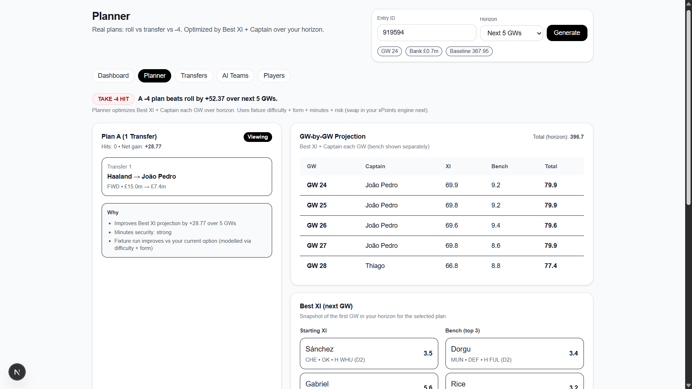
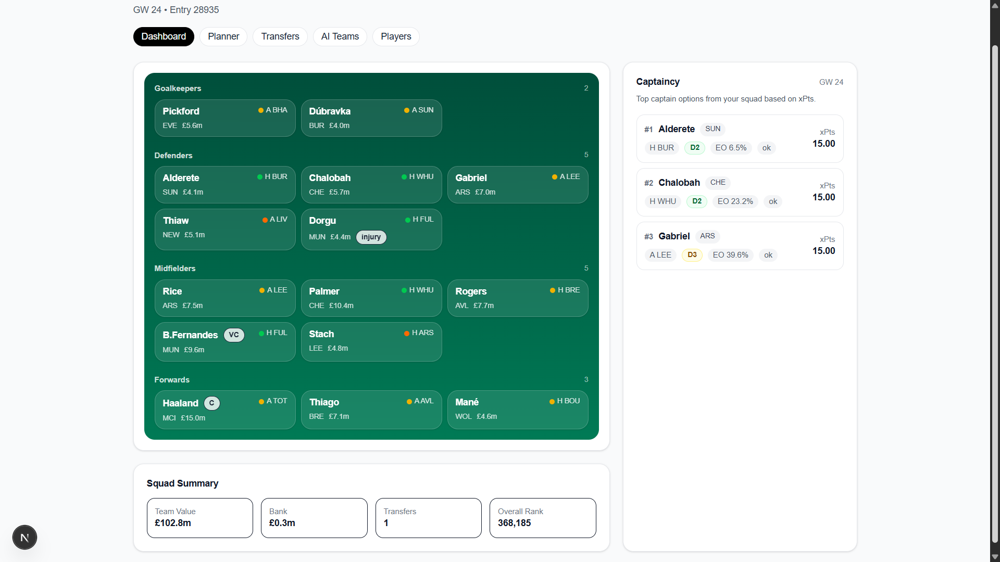

# ⚽ FPL Analytics Dashboard

A modern **Fantasy Premier League (FPL) analytics web app** built with **Next.js App Router**.  
It helps FPL managers analyze their squad, fixtures, and player performance using a clean, professional dashboard inspired by tools like Fantasy Football Hub and Fantasy Football Scout.

---

## 📸 Screenshot






## 🚀 Features

- 🔐 **Enter FPL Entry ID once** – works across the entire app
- 🏟️ **Pitch-based squad view**
  - Proper Starting XI & Bench
  - Position-aware layout
  - Click players for detailed stats
- 🧩 **Player cards**
  - Price, form, ownership
  - xPoints (Next GW & 5 GWs)
  - Upcoming fixture & difficulty
- 📊 **Analytics widgets**
  - Quick insights for the current gameweek
- 🧠 **Expandable architecture**
  - Built to support AI transfers, captaincy, and optimal team selection

---

## 🛠️ Tech Stack

- **Next.js** (App Router)
- **TypeScript**
- **React**
- **Tailwind CSS**
- **FPL Official APIs (proxied)**

---

## 🧭 How It Works

1. Enter your **FPL Entry ID**
2. App fetches:
   - Squad
   - Fixtures
   - Player stats
3. Data is stored globally → available everywhere
4. Dashboard renders:
   - Squad pitch
   - Widgets
   - Player drawer with deep stats

---

## 🏗️ Project Structure (Simplified)

```text
app/
 ├─ api/              # FPL API routes
 ├─ _components/      # UI components (Pitch, PlayerTile, Widgets)
 ├─ _state/           # Global dashboard context
 ├─ layout.tsx
 └─ page.tsx

---

## ▶️ Run locally

Requires Node.js 20 or newer.

```bash
cd web
npm install
npm run dev      # http://localhost:3000
```

No API key is needed: the app's own API routes call the public FPL API
(`https://fantasy.premierleague.com/api`) on the server, which avoids browser CORS errors.

## 📐 About the xPoints numbers

The expected-points figures are a hand-made heuristic, not a trained model. A player's FPL
form and expected goal involvements are combined, then scaled by fixture difficulty, position,
minutes played and availability (injury or doubt flags); see `web/app/api/_lib/projection.ts`.
The recommendations route also uses bookmaker match odds from football-data.co.uk (`odds.ts`).
Treat the numbers as a ranking aid.
